# 📸 شاشات النظام — عيادة

جولة مصوّرة في كل شاشة من شاشات نظام إدارة العيادات. الصور مأخوذة بحساب **المالك (super_admin)** على عرض 1440×900، والنسخة المعروضة تحتوي على بيانات تجريبية.

- **الواجهة العامة**: صفحة تعريفية + تسجيل الدخول + صفحة الحجز للمريض.
- **لوحة التحكم**: 16 شاشة موزّعة على مجموعات (الرئيسية، العيادة، المالية، الإدارة، الاشتراكات).

> ملاحظة: بعض الشاشات (مثل «إدارة الاشتراكات» و«إدارة العروض») تظهر لحساب المالك فقط؛ أما شاشات الطبيب والاستقبال فتظهر حسب الصلاحيات الممنوحة لكل دور (انظر قسم «شاشات الأدوار الأخرى» في الأسفل).

---

## 🌐 الواجهة العامة

### 1) الصفحة التعريفية (Landing) — `/`


الواجهة التسويقية العامة للنظام، وتضم الأقسام: المميزات، الأسعار (شهري/سنوي)، الإحصائيات، خطوات البدء، آراء العملاء، العروض، ودعوة للتسجيل. منها يصل الزائر إلى «تسجيل الدخول» أو «ابدأ مجاناً».

### 2) تسجيل الدخول — نافذة منبثقة


نافذة الدخول التي تفتح من زر «تسجيل الدخول». يدخل المستخدم باسم المستخدم وكلمة المرور، ويدعم النظام أيضاً رمز التحقق بخطوتين (2FA) لمن فعّله.

### 3) صفحة الحجز العامة للمريض — `/booking/al-noor-clinic`


صفحة مستقلة (بدون تسجيل دخول) مخصّصة لكل عيادة عبر رابط `bookingSlug`. يعرض المريض بيانات العيادة، يختار الخدمة والطبيب واليوم، ويدخل اسمه ورقمه، ثم يؤكد الحجز. **الوقت يُخصّص تلقائياً** لأقرب موعد متاح، ويُمنع حجز أكثر من موعد لنفس الرقم في نفس اليوم.

---

## 🖥️ لوحة التحكم

### 4) لوحة التحكم — الرئيسية


النظرة العامة: إحصائيات فورية (عدد المرضى، مواعيد اليوم، الإيرادات)، آخر المواعيد، التنبيهات، واختصارات سريعة لأهم الإجراءات.

### 5) المرضى


سجل المرضى الكامل: بحث وفلترة، إضافة/تعديل مريض، وعرض الملف الطبي (البيانات الأساسية، التاريخ المرضي، المواعيد والفواتير المرتبطة).

### 6) المواعيد


إدارة جدول المواعيد: عرض حسب اليوم/الأسبوع، إنشاء موعد (اختيار المريض، الطبيب، الخدمة، الوقت المحسوب تلقائياً حسب مدة الخدمة)، تعديل الحالة (مؤكّد/مكتمل/ملغى)، وتنبيهات التعارض.

### 7) السجلات الطبية


السجل الطبي الإلكتروني: ملاحظات الزيارة، التشخيص، الوصفات، والملفات المرفقة لكل مريض، مع إمكانية الرجوع للتاريخ الطبي الكامل.

### 8) الفواتير


إصدار الفواتير وربطها بالخدمات والمواعيد، متابعة المدفوع والمعلّق، وطرق الدفع (مدفوع كلياً / جزئي / آجل)، مع طباعة أو مشاركة الفاتورة.

### 9) المخزون


إدارة أصناف المخزون والمستلزمات: الكميات المتاحة، حد إعادة الطلب، الأسعار، والتنبيه عند انخفاض الكمية.

### 10) الديون


متابعة المبالغ المستحقة على المرضى (الفواتير غير المسدّدة)، مع إجماليات وتسجيل الدفعات الجزئية.

### 11) بيع المنتجات


نقطة بيع سريعة لمنتجات العيادة (مستحضرات/مستلزمات) مع حساب الإجمالي وخصم الكميات من المخزون.

### 12) التقارير


تقارير وتحليلات: الإيرادات، أداء الأطباء، أعداد المواعيد والمرضى، ورسوم بيانية قابلة للتصفية حسب الفترة.

### 13) المهام


قائمة مهام الفريق: إنشاء مهمة وإسنادها لموظف مع أولوية وموعد استحقاق ومتابعة حالتها.

### 14) الإعدادات


إعدادات العيادة والفريق: بيانات العيادة، العملة، ساعات العمل، صلاحيات وأدوار المستخدمين، ووحدات النظام المفعّلة.

### 15) إدارة العيادات


خاص بالمالك/المدير: إضافة عيادة جديدة، تعديل بيانات الفروع، وتخصيص المظهر والرابط العام للحجز لكل عيادة.

### 16) الخدمات والأسعار


إدارة قائمة الخدمات: الاسم، الوصف، **المدة بالدقائق** (من 1 إلى 10000)، والسعر، مع إظهار/إخفاء الخدمة. المدة التي تحددها هنا هي ما يراه المريض في صفحة الحجز وهي التي تُحسب عليها المواعيد.

### 17) الأمان


حماية الحساب: تغيير كلمة المرور (مع تسجيل خروج بقية الأجهزة فوراً)، وإدارة خيارات الأمان للمستخدم.

### 18) إدارة الاشتراكات

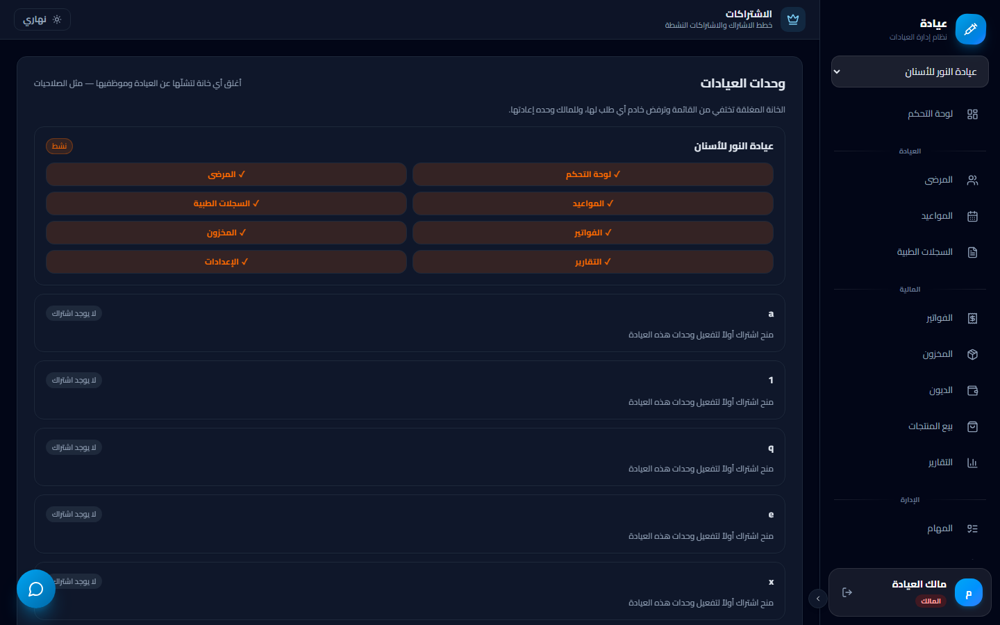

خاص بالمالك: إدارة خطط الاشتراك، منح/تجديد اشتراك للعيادات، ومتابعة الفترات التجريبية وحالات الاشتراك.

### 19) إدارة العروض

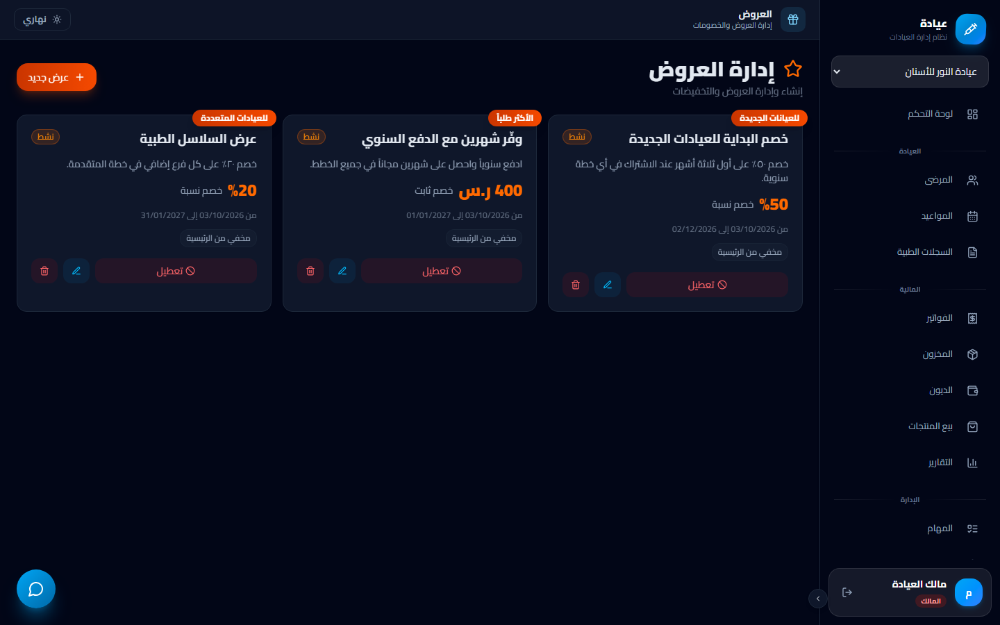

خاص بالمالك: إنشاء عروض وخصومات (نسبة أو مبلغ)، تحديد مدتها وإظهارها في الصفحة التعريفية.

---

## 🩺 شاشات الأدوار الأخرى

تختلف القائمة الجانبية حسب صلاحيات كل دور. التقطنا الشاشات كما تظهر فعلياً لحسابي **الطبيب** و**الاستقبال**.

### 👨‍⚕️ حساب الطبيب (`doctor`)

يرى الطبيب **5 شاشات** فقط: لوحة التحكم، المرضى، المواعيد، السجلات الطبية، والمهام — دون الجوانب المالية والإدارية.

#### لوحة تحكم الطبيب

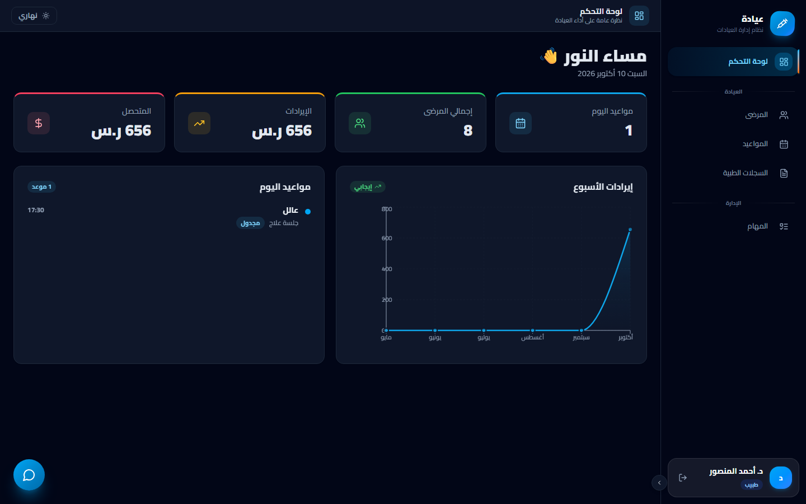

لوحة مختصرة تركّز على مواعيد اليوم الخاصة بالطبيب وقائمة مرضاه ومهامه، دون مؤشرات مالية.

#### المرضى (الطبيب)

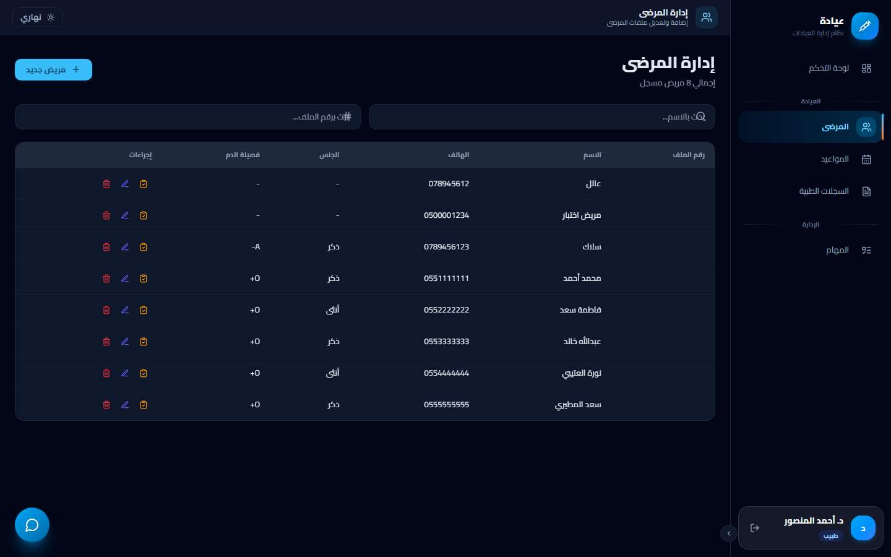

الوصول إلى ملفات المرضى لعرض البيانات والتاريخ الطبي وإضافة الملاحظات.

#### المواعيد (الطبيب)

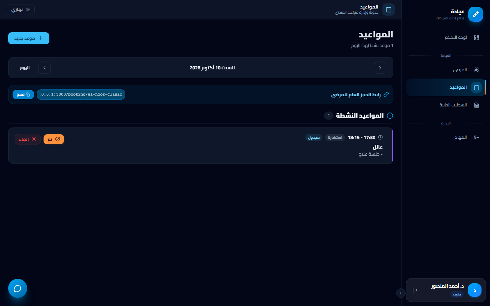

جدول مواعيد الطبيب ومتابعة حالاتها (مؤكّد/مكتمل) دون إدارة الفواتير.

#### السجلات الطبية (الطبيب)

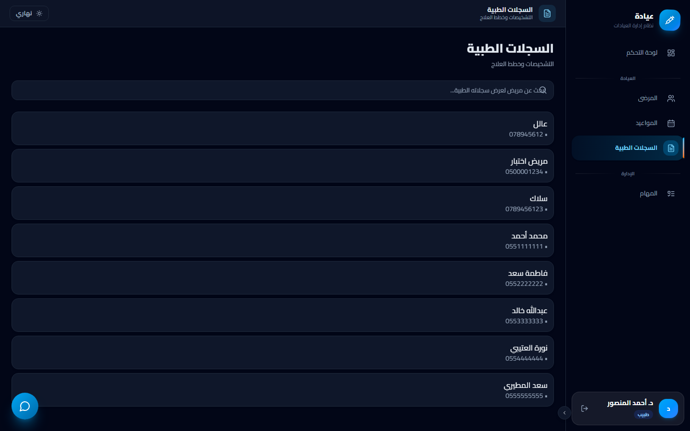

تدوين الزيارة والتشخيص والوصفة الطبية وإرفاق الملفات.

#### المهام (الطبيب)

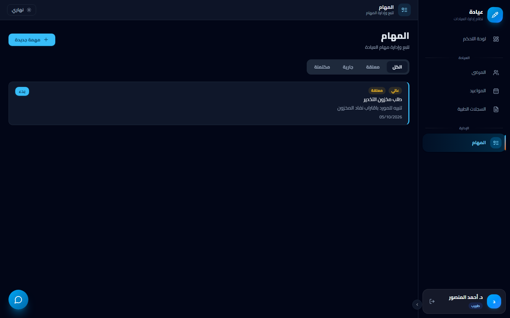

المهام المسندة إلى الطبيب ومتابعة إنجازها.

### 💁 حساب الاستقبال (`reception`)

يرى موظف الاستقبال **6 شاشات**: لوحة التحكم، المرضى، المواعيد، الفواتير، الديون، والمهام.

#### لوحة تحكم الاستقبال

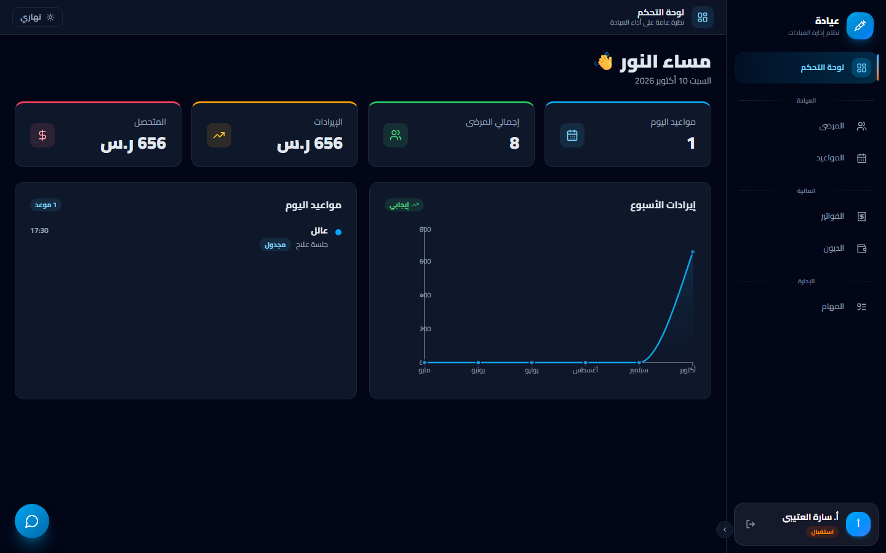

نظرة عامة على مواعيد اليوم والحجوزات الجديدة الواردة من صفحة الحجز العامة.

#### المرضى (الاستقبال)

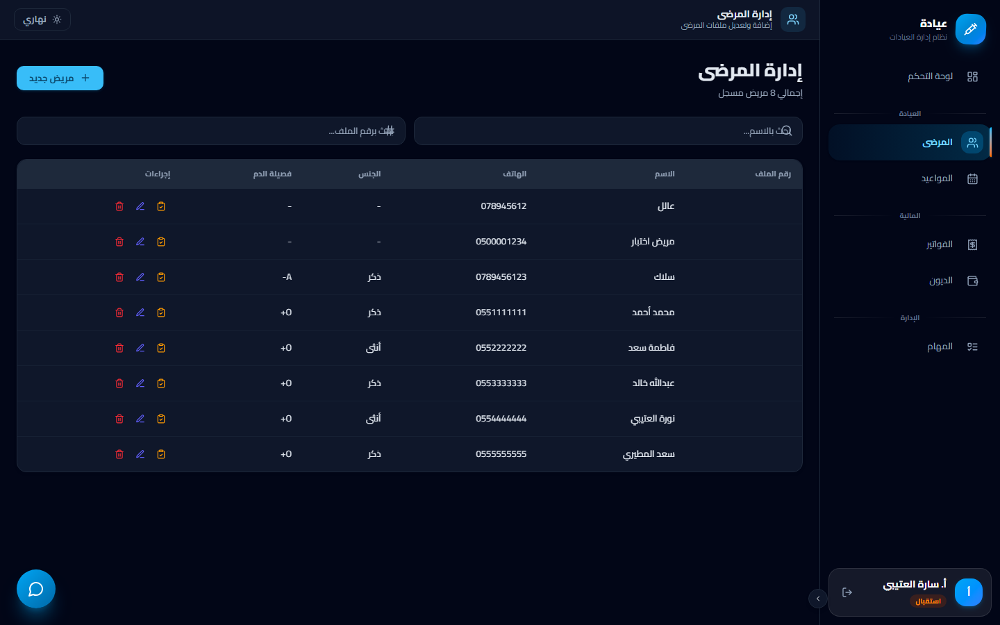

تسجيل المرضى الجدد والبحث عن المرضى القدامى وإدارة بياناتهم الأساسية.

#### المواعيد (الاستقبال)

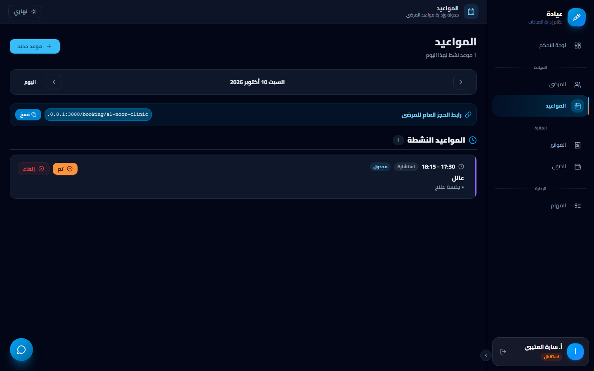

إدارة جدول المواعيد: الحجز وتأكيد المواعيد الواردة وتعديلها.

#### الفواتير (الاستقبال)

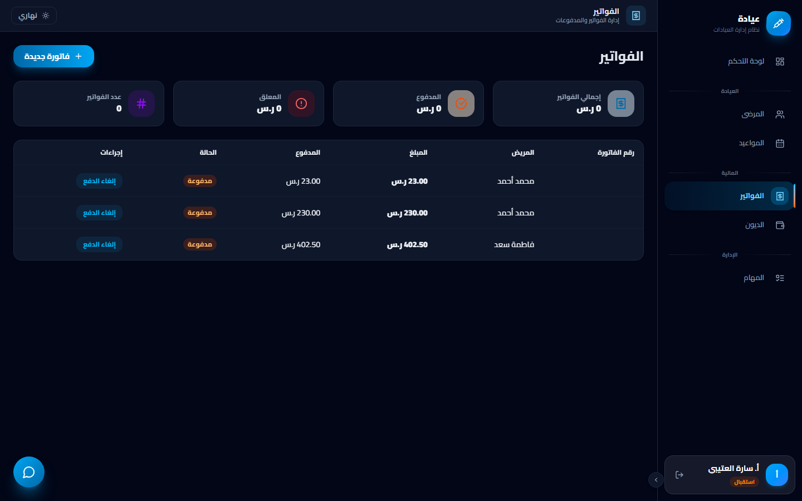

إصدار الفواتير وتحصيل المدفوعات وتسجيل طرق الدفع.

#### الديون (الاستقبال)

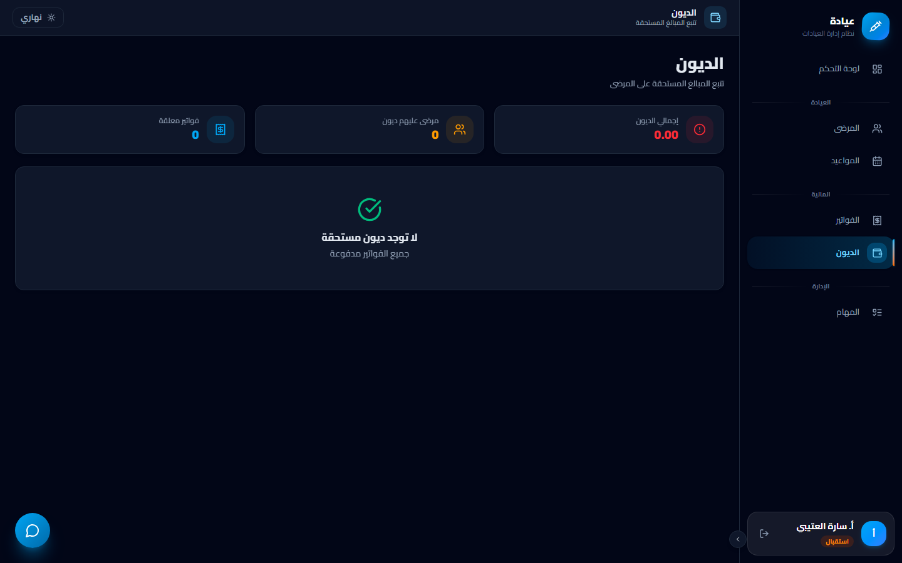

متابعة المبالغ المستحقة على المرضى وتسجيل الدفعات الجزئية.

#### المهام (الاستقبال)

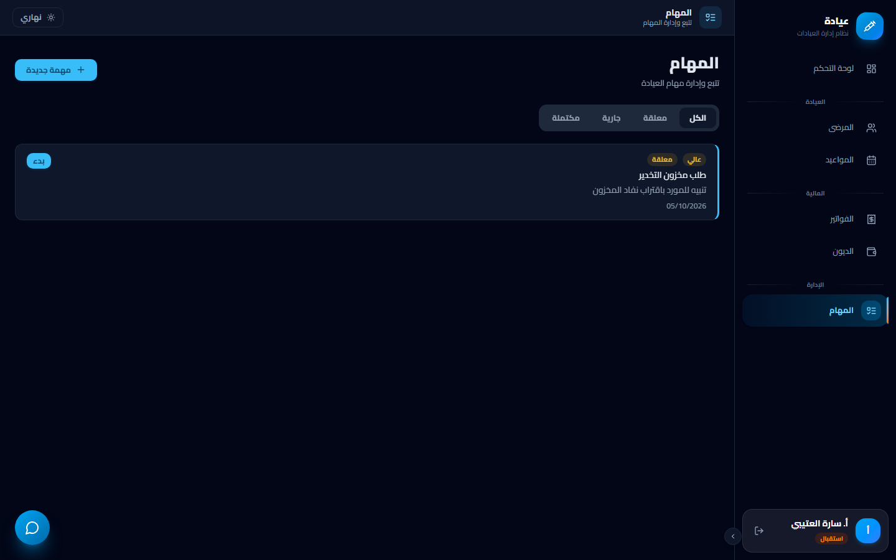

المهام المسندة إلى موظف الاستقبال ومتابعتها.

---

## 🗂️ تنظيم الملفات

```
docs/
├── SCREENS.md            ← هذا الملف (الشرح + الصور)
└── screenshots/
    ├── 01-landing.png
    ├── 02-login.png
    ├── 03-booking.png
    ├── 04-dashboard.png
    ├── 05-patients.png
    ├── 06-appointments.png
    ├── 07-records.png
    ├── 08-invoices.png
    ├── 09-inventory.png
    ├── 10-debts.png
    ├── 11-product-sales.png
    ├── 12-reports.png
    ├── 13-tasks.png
    ├── 14-settings.png
    ├── 15-management.png
    ├── 16-services.png
    ├── 17-security.png
    ├── 18-subscriptions.png
    ├── 19-offers.png
    ├── 20-doctor-dashboard.png
    ├── 21-doctor-patients.png
    ├── 22-doctor-appointments.png
    ├── 23-doctor-records.png
    ├── 24-doctor-tasks.png
    ├── 25-reception-dashboard.png
    ├── 26-reception-patients.png
    ├── 27-reception-appointments.png
    ├── 28-reception-invoices.png
    ├── 29-reception-debts.png
    └── 30-reception-tasks.png
```

## 🔁 إعادة توليد الصور

كل الصور التُقطت من التطبيق الحي على `http://127.0.0.1:3000` عبر بروتوكول Chrome DevTools. لتحديثها بعد أي تغيير في الواجهة، شغّل السيرفر (`node server.js`) ثم أعد التصوير من نفس الروابط والحساب.
